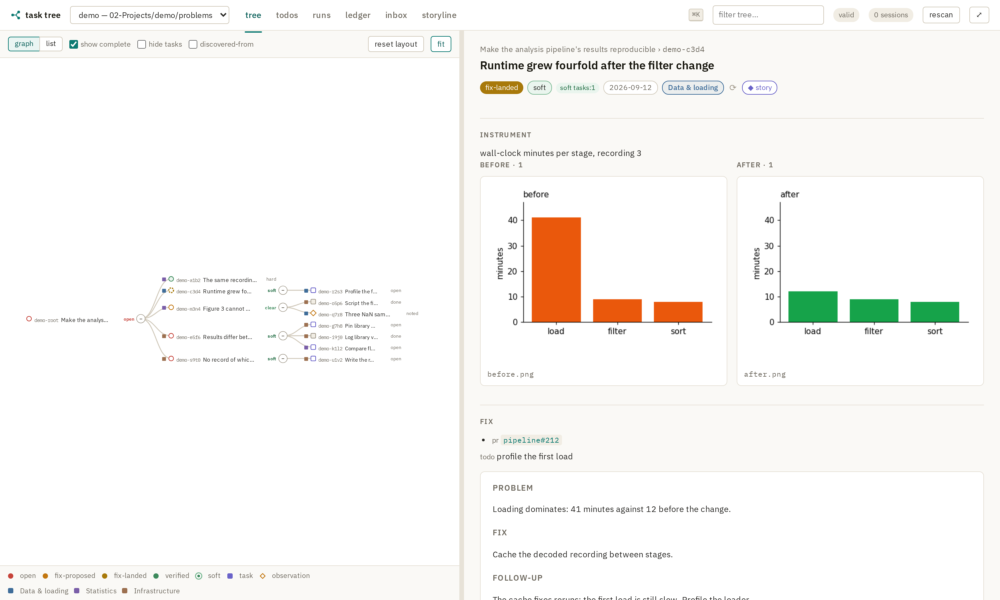
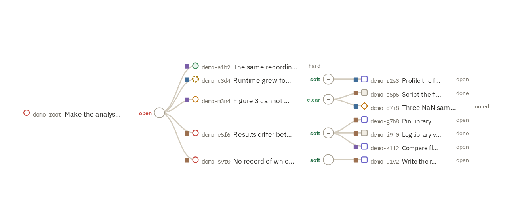
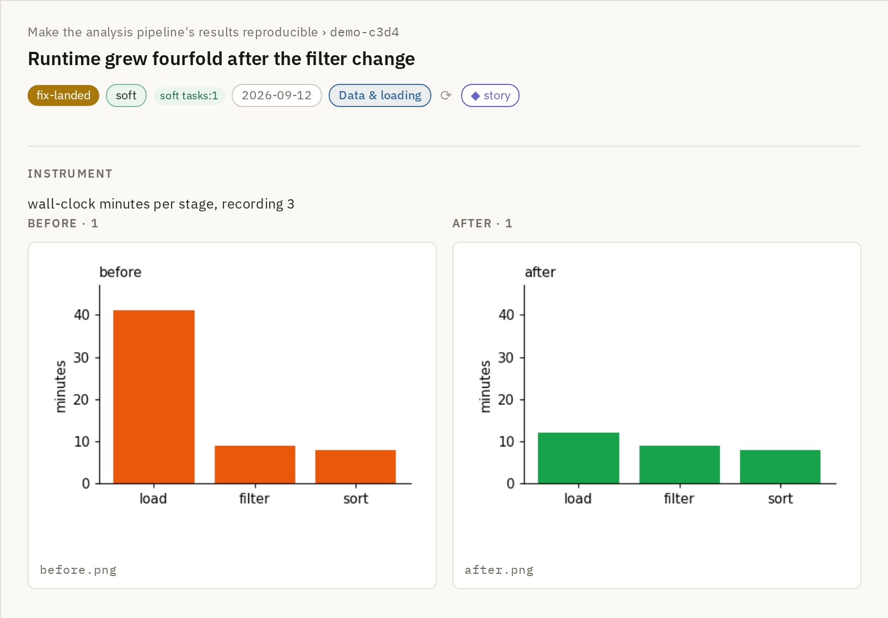
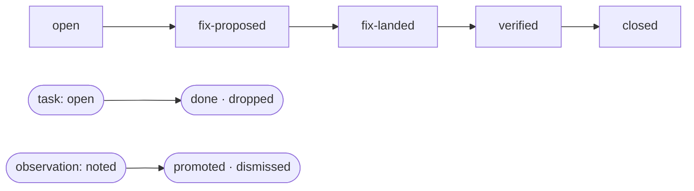
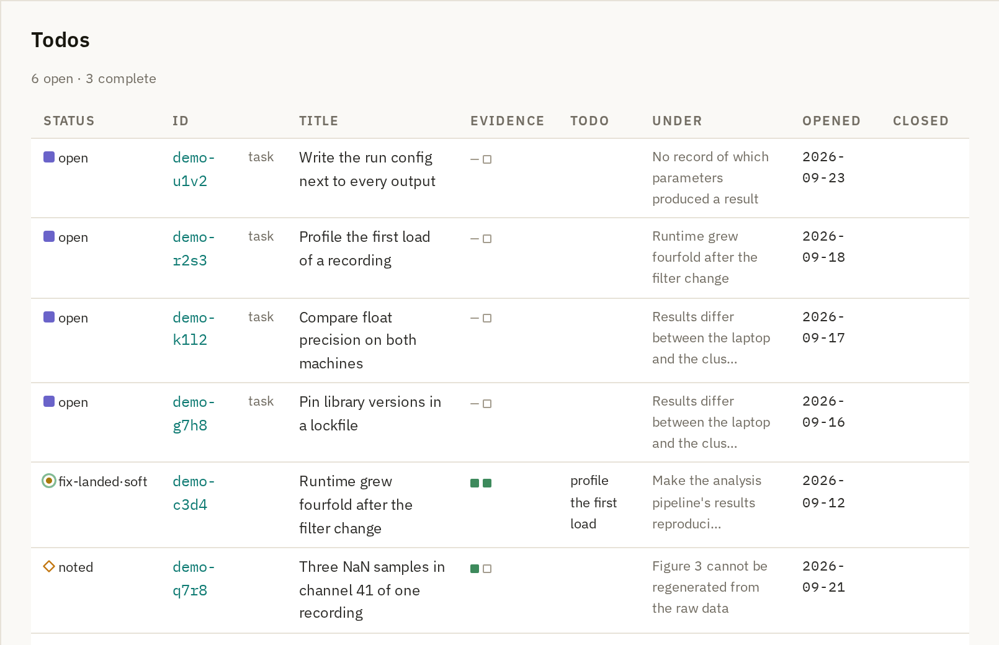
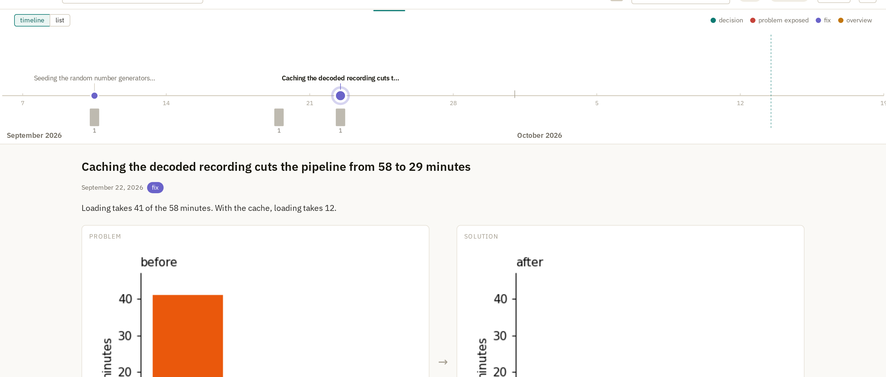

# problem-tree

A task tree for research projects, kept as plain Markdown notes and browsed in a small web app. Humans and
coding agents (Claude Code, pi, …) work from the same tree: every piece of work is a node, every node says
where it came from and what showed it was done, and a validator keeps the tree honest.



*The pictures on this page come from the toy project in [`example/`](example/). It is invented; nothing in it is real data.*

## The tree

One base problem sits at the root. Work that turns up on the way down becomes a child node; nodes close as
their children resolve.



| node | shape | what it is |
|---|---|---|
| **problem** | circle | something wrong that a measurement shows, fixed by a change later work inherits |
| **task** | square | everything else met on the way: bugs, paths, plots, refactors |
| **observation** | diamond | an issue seen and evidenced, parked on purpose; never counted as open work |

Each node is one file, `problems/<id>.md`, with a few lines of frontmatter:

```yaml
type: problem
id: demo-c3d4
title: Runtime grew fourfold after the filter change
parent: demo-root
status: fix-landed
resolution: soft              # ok for now, with a todo left
instrument: "wall-clock minutes per stage, recording 3"
before: [{artifact: ../media/problems/demo-c3d4/before.png}]
after:  [{artifact: ../media/problems/demo-c3d4/after.png}]
fix:    [{pr: pipeline#212}]
```

## Evidence

A problem is not closed on someone's say-so. It needs a *before* figure showing the problem and an *after*
figure from the same measurement. The cockpit shows them side by side, and `validate.py` refuses a
`verified` problem that lacks either.





## What is left to do

The **todos** tab lists every open leaf. Two squares per row show whether the before and after evidence
exists; finished work is dimmed below.



## Storyline

The tree is the detailed record. The **storyline** tab is the short version for people: one *story point* per
milestone, with a plain-language summary and a problem figure next to a solution figure. Tasks closed per
day appear as bars under the timeline.



## Working with agents

Agents state which node they are working on, open tasks under it, and file evidence in the node. The cockpit
finds the chat sessions that mention each node, so a node leads back to the conversation that worked on it.
Three skills in [`skills/`](skills/) keep the tree current:

- **wrap-up** closes a session's bookkeeping: nodes current, evidence filed, validator run.
- **brief** writes a self-contained prompt for a child node, so a fresh session can pick it up.
- **storyline** proposes a story point and writes it once you approve the figures.

## Try it

```
pip install -r requirements.txt
python validate.py example/vault/02-Projects/demo/problems --tree         # the tree, with rollups
PROBLEM_TREE_CONFIG=example/config.yaml python serve.py                    # then open http://127.0.0.1:8891
```

For your own project: `cp config.example.yaml config.yaml`, point `vault:` at your notes, then create the
root with `python new.py <vault>/.../problems problem --root --prefix xyz --title "What you are trying to solve"`.

## Where things are

| | |
|---|---|
| `SPEC.md` | the schema, invariants, and reasoning |
| `AGENTS.md` | commands, configuration, and rules for agents using or changing the tool |
| `validate.py`, `new.py` | check the tree; create nodes |
| `serve.py`, `webui/` | the cockpit (FastAPI and a hand-written SVG front end) |
| `templates/` | one template per node type |
| `skills/` | the agent skills |
| `example/` | the toy project behind the pictures, and the scripts that regenerate them |
